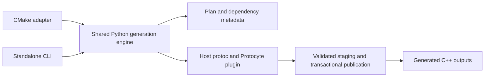

# A fast generation engine with simple integration

## Recommendation and user contract

Make planning, output ownership and publication a build-system-independent Python
engine. Keep CMake for packaging/exported C++ targets and as a thin, convenient
build adapter. Add a standalone CLI backed by the same engine.

Ease of use is an acceptance criterion, not a later documentation task:

- Existing consumers should keep their familiar `protocyte_add_proto_library`,
  `protocyte_generate` and descriptor-set helper calls.
- Source/FetchContent users should configure and build without a separate global
  plugin install or manual environment activation.
- Installed-prefix users should retain `find_package(protocyte CONFIG REQUIRED)`
  and the current runtime targets, including read-only/relocatable prefixes.
- A standalone user should supply schemas and an output location, with managed
  state/tool selection handled automatically. Configuration files are optional.
- Users should not select registry partitions, cache modes, lock strategies or
  migration flags. Normal upgrades preserve ownership; conflicts remain explicit.

The proposed standalone command is **new functionality**, not an existing command:

```console
protocyte generate --proto-root proto --out-dir build/generated
```

The ordinary CMake call can remain:

```cmake
protocyte_add_proto_library(
    TARGET application_proto
    PROTO_ROOT "${CMAKE_CURRENT_SOURCE_DIR}/proto"
    DISCOVER
    HOSTED_ALLOCATOR
)
target_link_libraries(application PRIVATE application_proto)
```

The CLI may later have optional configuration for repeated complex arguments;
the basic case must not require users to author manifests or inventory files.
Python remains the current prerequisite. This design adds no native helper build,
service, database installation or extra process that users must manage.

## Architecture and responsibilities



Suggested boundaries, introduced only as their contracts become clear:

| Layer | Responsibility |
| --- | --- |
| Request/planning API | Normalize generation specs, reuse dependency/output naming logic, return task and dependency metadata |
| Record model | Decode/authenticate claims and plans, bind builds/targets, validate snapshots and transaction intent |
| Filesystem layer | Projection, aliases, ordinary-directory checks, missing components, physical identities and observation lifetime |
| Ownership index | All retained root/staging reservations, containment in both directions and existing ownership/retirement exceptions |
| Transaction engine | Locks, staging, durable intent, publication, retirement, recovery and reset |
| Adapters | Public arguments, C++ build targets, depfile/build metadata and presentation |

Start with Python 3.12 and the existing standard-library-only coordinator code.
The generator already lives in the Python package; the coordinator can become
its build-engine subpackage without bringing protobuf-dependent imports into the
bootstrap/filesystem layer. Existing claims and write-ahead transactions remain
the initial storage/protocol format. A persistent database or daemon is not
necessary to test the indexed algorithm.

Conceptual internal API:

```python
prepared = engine.prepare(build_root, generation_specs)
engine.run(prepared.task(target_id))
```

`prepare` batches declarations for the entire build and returns generated task
descriptions, outputs, dependency metadata and ownership binding. `run` performs
fresh task/claim validation, generation into staging and publication. Validation
and ownership-aware reset remain explicit internal entry points.

Adapters create the task files automatically. They are versioned machine data,
not another configuration language for users. Requests must preserve Unicode,
spaces, semicolons and Windows path spellings without shell-command construction.
Keep the existing path transport until a replacement passes the transport tests.

The public CLI should have a stable default build identity across invocations,
derived from its build scope rather than a new random owner every time. A build
directory override can be optional. The CMake adapter supplies its binary build
root as it does today. Different adapters must not silently adopt one another's
outputs merely because the requested directory matches.

## How CMake becomes smaller

CMake should declare C++ targets, configure dependency edges and invoke the engine.
At configure time it submits one batch of generation specs. At build time it
invokes one engine task for each generation job. The engine handles compiler
response files, staging, task validation and publication in one orchestration
process; the compiler/plugin remain subprocesses as required by their protocol.

This replaces the current recursive CMake/Python generation wrapper chain. It
also gives other build systems access to the same safe pipeline. Dependency
discovery remains available before CMake must declare outputs, with correct
no-op builds, import-change detection and multi-config behavior.

The current #52 behavior already batches registry reconciliation. The new adapter
must preserve that and must not call a full `prepare` separately for each target.
Moving orchestration out of CMake simplifies ownership and process flow, but it
does not itself solve the 750-second validation: the standalone Python POC
reproduces that cost without running CMake.

Do not delete a CMake filesystem check just because similarly named Python code
exists. Map every current guard to its replacement boundary and keep the old
guard until the backend covers its safety contract and relevant race cases.

## Packaging and tool provisioning

The current CMake install already carries the Python project under
`share/protocyte/python`, alongside the installed CMake configuration and runtime
headers/targets. Reuse that model:

- The Python wheel contains the engine, CLI, existing protoc plugin and runtime/
  schema data. Preserve `protoc-gen-protocyte`; add a separate `protocyte` entry
  point so plugin stdin/stdout remains a binary protocol.
- FetchContent uses the checked-out Python sources. Installed-prefix consumption
  uses the bundled Python project, selected explicitly from that prefix.
- The CMake coordinator launcher becomes a small compatibility entry point using
  those exact sources. It must work before protobuf is installed, without finding
  an unrelated globally installed package through the environment or working dir.
- Keep the existing managed-environment version/fingerprint checks and pinned
  dependencies. Extend both source and installed generator-source dependency
  lists to cover the new backend modules.
- Source and installed-package paths use the same engine version. A moved or
  read-only package prefix must stay untouched; writable state belongs in the
  consumer build/cache locations.

Host tool resolution should be shared behind the interfaces. Ordinary supported
hosts can reuse supplied/compatible tools or acquire pinned, verified host tools
automatically where the integration allows it. Offline users and cross builds
keep explicit local host-tool overrides. Target compiler settings must not turn
`protoc` into an executable for the target platform. A new CLI should not need
CMake merely to orchestrate normal generation.

## Performance design and safety boundary

The algorithmic work belongs in the engine:

1. Read and validate each immutable record once under the registry lock.
2. Separate record decoding/hashing from path-dependent authentication.
3. Observe distinct locations/components through an explicit validation context.
4. Build a transient index of all physical/lexical root and staging reservations.
5. Query that index for the current plans, and revalidate authority at the
   required mutation boundaries.

The desired metadata cost tracks unique paths/components and the required
validation passes, rather than retained claims multiplied by current plans.
See [the 30-second assessment](registry-validation-30s-plan.md) for measurements,
the authentication cost budget and the indexed algorithm's unresolved proof.

This is not a general `Path.resolve` cache. An observation context must define
which names, directory identities and missing-component observations it relies
on; what makes them invalid; how it detects that; and what is freshly checked
before mutation. Registry locking does not freeze external topology, and two
matching metadata sweeps alone are not sufficient proof. In particular, validating
only the current output root does not protect a negative conflict result that
depends on a changed foreign path.

Keep the existing shared registry, records, claim lifecycle and lock order for
the first implementation. Do not acquire registry while holding generation
locks: `prepare` finishes and releases its locks before `run` acquires its
generation/publication locks. `run` freshly rejects a task made stale in that
interval. Any later lock-wait optimization must remain compatible with old
coordinator processes sharing the namespace.

The index is a candidate optimization until its observation/commit contract is
reviewable and preserves alias, reparse, path-replacement, ownership, concurrent
writer and recovery behavior. A safe fallback or fail-closed error is required
for unsupported/unstable topology; fallback time and occurrence must be measured
and cannot be hidden when claiming the 30-second target.

## Implementation sequence

1. **Define contracts and benchmark fixtures.** Freeze the existing engine as a
   behavioral reference. Establish the 2,172-claim/11-plan workload plus anonymous
   existing/missing-root, depth, target-count and shared-build variants. Inventory
   the filesystem guarantees currently supplied by both CMake and Python.
2. **Prove the new validation core behind the current entry point.** Refactor
   record authentication and prototype the indexed observation model with 64/256
   claims first. Keep the current public helpers and generation path while
   resolving the safety proof. Proceed to larger cases only after the operation
   counts and measured budget justify them. This is the first decisive milestone.
3. **Package the proven engine.** Move the established boundaries into the Python
   package, retaining a compatibility launcher and record/lock interoperability.
   Make the POC and benchmark import the real implementation and fingerprint its
   source bundle. Measuring a thin launcher and reporting zero projections would
   be a false improvement.
4. **Thin the CMake adapter incrementally.** Move one orchestration responsibility
   at a time, retaining transport, dependency, timeout, cross-build, multi-config,
   ownership and recovery tests. Remove replaced CMake guards only after proving
   equivalent protection at the corresponding engine boundary.
5. **Expose the standalone CLI.** Reuse the exact planning/run API and shared
   ownership rules. Test the one-command normal case and actionable failures;
   do not make users operate the internal protocol or reset state to upgrade.

Do not combine a new database, registry-format migration, lock-order change,
language rewrite and user-facing configuration system with this first fix.
Those would obscure whether the algorithm is faster and whether safety survived.

## Acceptance criteria

- All validation, including authentication and required freshness checks, is
  below 30 seconds for the stated 2,172/11 benchmark environments; aim below
  25 seconds to leave margin. Report setup, lock wait and reconciliation separately.
- Metadata operation growth follows unique geometry/reservations, with every
  retained claim still authenticated and all overlap/ownership rules retained.
- Adversarial mutation, alias, concurrent-writer and crash-recovery tests pass,
  alongside a reviewed argument for the new observation lifetime.
- Existing quickstart, FetchContent, installed-prefix and superbuild consumers
  work without new project configuration or manual environment activation.
- Moved/read-only prefixes, offline tool overrides and cross compilation remain
  supported, with explicit host-tool selection where required.
- An unchanged second build does no unnecessary code generation; import and
  tool/backend changes still trigger the appropriate work.
- The new standalone normal case works through one command after tool installation.
  Internal task manifests, registry maintenance and performance switches stay
  out of the required user workflow.

This document is an implementation proposal. The new CLI and packaged backend
described here have not been implemented, and the 30-second target is not yet proven.
